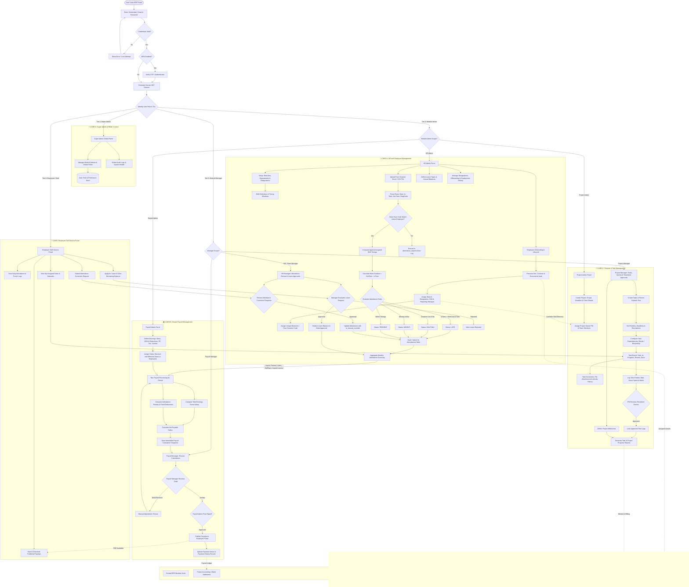

# Full Specification ERP Architecture: HR, Simple Payroll & Projects

Yeh document tere poore specifications ko cover karta hai:
- **Module A: HR and Employee Management** (Full Lifecycle, Documents, Shifts, Corrections, Balances, Branches)
- **Module B: Simple Payroll Management** (Structures, Components, Effective dates, Snapshots, Publishing, Straightforward approach)
- **Module C: Projects and Task Management** (Milestones, Parent/Subtasks, Dependencies, Comments, Attachments, Activity, Timesheets)

---

## 1. End-to-End System Flowchart (Mermaid)

---

## 2. Complete Database Schema (ERD Mermaid)

```mermaid
erDiagram
    %% ================= CORE & RBAC RELATIONS =================
    users ||--o{ user_roles : "assigned"
    roles ||--o{ user_roles : "defines"
    roles ||--o{ role_permissions : "contains"
    permissions ||--o{ role_permissions : "granted_to"
    users ||--o{ audit_logs : "performed_by"

    %% ================= HR & EMPLOYEE RELATIONS =================
    branches ||--o{ employees : "assigned_to_branch"
    departments ||--o{ designations : "has"
    departments ||--o{ employees : "belongs_to"
    designations ||--o{ employees : "positioned_as"
    users ||--o| employees : "account_profile"
    employees ||--o{ employees : "reporting_manager_of"
    shifts ||--o{ employee_shifts : "assigned_shift"
    employees ||--o{ employee_shifts : "has_shift"
    employees ||--o{ employee_documents : "uploaded_docs"
    employees ||--o{ employment_history : "lifecycle_events"

    %% ================= ATTENDANCE & LEAVES RELATIONS =================
    employees ||--o{ attendances : "daily_records"
    attendance_imports ||--o{ attendances : "source_batch"
    employees ||--o{ attendance_corrections : "requests_correction"
    users ||--o{ attendance_corrections : "approved_by"
    leave_types ||--o{ leave_balances : "category"
    employees ||--o{ leave_balances : "available_balance"
    leave_types ||--o{ leaves : "classified_as"
    employees ||--o{ leaves : "requested_by"
    users ||--o{ leaves : "manager_approval"

    %% ================= PAYROLL RELATIONS =================
    salary_structures ||--o{ salary_components : "comprises"
    employees ||--o{ employee_salary_assignments : "assigned_structure"
    salary_structures ||--o{ employee_salary_assignments : "structure_used"
    payroll_periods ||--o{ payroll_batches : "cycle"
    payroll_batches ||--o{ employee_payrolls : "contains"
    employees ||--o{ employee_payrolls : "receives_salary"
    employee_payrolls ||--o{ payroll_snapshots : "immutable_record"
    employee_payrolls ||--o{ payment_history : "payout_trail"

    %% ================= PROJECT & TASK RELATIONS =================
    projects ||--o{ project_milestones : "milestones"
    projects ||--o{ project_members : "team"
    employees ||--o{ project_members : "member"
    users ||--o{ projects : "owned_by"
    projects ||--o{ tasks : "has_tasks"
    tasks ||--o{ tasks : "parent_subtask"
    tasks ||--o{ task_dependencies : "prerequisite_of"
    employees ||--o{ tasks : "assigned_to"
    tasks ||--o{ task_comments : "has_comments"
    tasks ||--o{ task_attachments : "has_files"
    tasks ||--o{ task_activities : "audit_history"
    tasks ||--o{ task_timesheets : "time_logged"
    employees ||--o{ task_timesheets : "logged_by"
    users ||--o{ task_timesheets : "approved_by_pm"

    %% ================= TABLE DEFINITIONS =================

    users {
        uuid id PK
        string name
        string email
        string password_hash
        string phone
        string status "active, inactive"
        datetime created_at
    }

    roles {
        uuid id PK
        string name "super_admin, module_admin, module_manager, employee"
        string tier_level "tier_1, tier_2, tier_3, tier_4"
        string module_scope "core, hr, payroll, projects, all"
        string description
    }

    permissions {
        uuid id PK
        string code "e.g. hr.leave.approve, project.task.assign"
        string module_name
    }

    user_roles {
        uuid user_id FK
        uuid role_id FK
    }

    role_permissions {
        uuid role_id FK
        uuid permission_id FK
    }

    audit_logs {
        uuid id PK
        uuid user_id FK
        string module_name
        string action
        string record_id
        json old_value
        json new_value
        datetime timestamp
    }

    branches {
        uuid id PK
        string branch_name
        string branch_code
        string city
        string address
        boolean is_active
    }

    departments {
        uuid id PK
        string name
        string code
    }

    designations {
        uuid id PK
        uuid department_id FK
        string title
    }

    shifts {
        uuid id PK
        string shift_name
        time start_time
        time end_time
        int grace_period_minutes
        decimal half_day_threshold_hours
        decimal full_day_threshold_hours
    }

    employees {
        uuid id PK
        uuid user_id FK
        string employee_code UK
        string biometric_emp_code UK "Face Scanner ID"
        uuid branch_id FK
        uuid department_id FK
        uuid designation_id FK
        uuid reporting_manager_id FK "Self-referencing Manager FK"
        date joining_date
        date exit_date
        string employment_status "active, probation, notice, exited"
        string contact_email
        string contact_phone
        text current_address
        text permanent_address
    }

    employee_shifts {
        uuid id PK
        uuid employee_id FK
        uuid shift_id FK
        date effective_from
        date effective_to
    }

    employee_documents {
        uuid id PK
        uuid employee_id FK
        string document_type "id_proof, offer_letter, resume, certificate"
        string document_name
        string file_url
        datetime uploaded_at
    }

    employment_history {
        uuid id PK
        uuid employee_id FK
        string event_type "joined, promoted, transferred, designation_change, exited"
        text remarks
        date event_date
    }

    attendance_imports {
        uuid id PK
        string file_name
        uuid uploaded_by FK
        int total_rows
        int success_count
        int failed_count
        json error_log
        datetime uploaded_at
    }

    attendances {
        uuid id PK
        uuid employee_id FK
        uuid import_id FK "Nullable if manual"
        date date
        time check_in_time
        time check_out_time
        decimal work_duration_hours
        string status "Present, Late, Half-Day, Absent"
        boolean is_manual_override
    }

    attendance_corrections {
        uuid id PK
        uuid employee_id FK
        uuid attendance_id FK
        date requested_date
        time requested_in_time
        time requested_out_time
        text reason
        string status "pending, approved, rejected"
        uuid reviewed_by FK
        datetime reviewed_at
    }

    leave_types {
        uuid id PK
        string leave_name "Casual, Sick, Paid, Unpaid"
        int default_days_per_year
        boolean is_paid
    }

    leave_balances {
        uuid id PK
        uuid employee_id FK
        uuid leave_type_id FK
        int year
        decimal total_allocated
        decimal used_days
        decimal balance_remaining
    }

    leaves {
        uuid id PK
        uuid employee_id FK
        uuid leave_type_id FK
        date start_date
        date end_date
        decimal days_count
        text reason
        string status "pending, approved, rejected"
        uuid approved_by_id FK
        datetime reviewed_at
    }

    salary_structures {
        uuid id PK
        string structure_name "e.g. Standard Executive, Tech Lead"
        text description
        boolean is_active
    }

    salary_components {
        uuid id PK
        uuid salary_structure_id FK
        string component_name "Basic, HRA, Medical, PF, TDS"
        string component_type "earning, deduction"
        decimal default_amount
        boolean is_percentage
    }

    employee_salary_assignments {
        uuid id PK
        uuid employee_id FK
        uuid salary_structure_id FK
        decimal base_gross_amount
        date effective_from
        date effective_to
        boolean is_current
    }

    payroll_periods {
        uuid id PK
        string period_name "e.g. October 2026"
        date start_date
        date end_date
        int total_working_days
    }

    payroll_batches {
        uuid id PK
        uuid payroll_period_id FK
        string batch_status "draft, reviewed, approved, published"
        uuid processed_by FK
        uuid approved_by FK
        datetime processed_at
    }

    employee_payrolls {
        uuid id PK
        uuid payroll_batch_id FK
        uuid employee_id FK
        int days_present
        int days_absent
        int days_leave_paid
        int days_leave_unpaid
        decimal total_earnings
        decimal total_deductions
        decimal net_salary
        string payment_status "unpaid, pending, paid"
    }

    payroll_snapshots {
        uuid id PK
        uuid employee_payroll_id FK
        json earnings_breakdown
        json deductions_breakdown
        json attendance_summary_snapshot
        datetime snapshotted_at
    }

    payment_history {
        uuid id PK
        uuid employee_payroll_id FK
        decimal amount_paid
        string payment_method "bank_transfer, cheque, cash"
        string transaction_reference
        datetime payment_date
        uuid recorded_by FK
    }

    projects {
        uuid id PK
        string project_name
        string project_code UK
        string client_name
        text description
        date start_date
        date end_date
        string status "planning, active, on_hold, completed"
        uuid owner_user_id FK
    }

    project_milestones {
        uuid id PK
        uuid project_id FK
        string milestone_title
        date due_date
        string status "pending, achieved"
    }

    project_members {
        uuid id PK
        uuid project_id FK
        uuid employee_id FK
        string project_role "project_manager, lead, contributor, reviewer"
    }

    tasks {
        uuid id PK
        uuid project_id FK
        uuid parent_task_id FK "Self-referencing for Subtasks"
        uuid assigned_to_employee_id FK
        string task_title
        text task_description
        string priority "low, medium, high, urgent"
        string status "todo, in_progress, review, done"
        date due_date
    }

    task_dependencies {
        uuid id PK
        uuid task_id FK
        uuid depends_on_task_id FK "Task that must be completed first"
        string dependency_type "blocks, finishes_with"
    }

    task_comments {
        uuid id PK
        uuid task_id FK
        uuid user_id FK
        text comment_text
        datetime created_at
    }

    task_attachments {
        uuid id PK
        uuid task_id FK
        string file_name
        string file_url
        uuid uploaded_by FK
        datetime uploaded_at
    }

    task_activities {
        uuid id PK
        uuid task_id FK
        uuid user_id FK
        string activity_type "status_changed, assigned, deadline_updated"
        text activity_details
        datetime created_at
    }

    task_timesheets {
        uuid id PK
        uuid task_id FK
        uuid employee_id FK
        date log_date
        decimal hours_spent
        text notes
        string approval_status "submitted, approved, rejected"
        uuid approved_by_pm_id FK
    }
```

