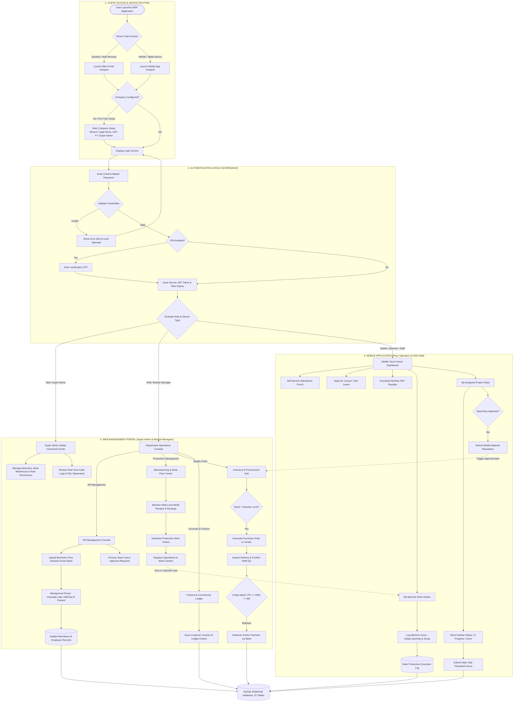

# Enterprise Manufacturing ERP: System Architecture & Dual-Platform Flowchart

---

## 1. Executive Technical Overview

This architecture document formally outlines the multi-tier system topology and unified workflow for the **Enterprise Manufacturing ERP System**. 

The solution is architected as a **Dual-Platform Ecosystem** powered by a single cross-platform codebase (Flutter) connecting to a modular RESTful backend (Node.js/Express) and relational persistence layer (MySQL).

### Dual-Platform Client Strategy:
1. **Web & Desktop Application**:
   - **Target:** Manufacturing Companies & Enterprise Businesses.
   - **Focus:** Complete operational management, production planning (BOM), inventory control, 3-way accounts matching, bulk biometric attendance processing, and executive reporting on a desktop-optimized dashboard.

2. **Mobile Application**:
   - **Target:** Factory Floor, On-Site & Field Workforce Operations.
   - **Focus:** Real-time shop-floor execution, machine operation logs, quick raw material requests, task updates, and employee self-service (attendance & leaves) on a mobile-first interface.

---

## 2. Multi-Tier System Topology Diagram

```
┌────────────────────────────────────────────────────────────────────────────────────────┐
│                                 PRESENTATION LAYER (UI)                                │
│                                                                                        │
│   ┌──────────────────────────────────────────┐  ┌────────────────────────────────────┐ │
│   │        WEB APP (Management Portal)       │  │    MOBILE APP (Worker / Staff)     │ │
│   │  - Super Admin Corporate Control         │  │  - Self-Service Punch & Leaves     │ │
│   │  - Production Routing & BOM Designer     │  │  - Machine Downtime & Scrap Log    │ │
│   │  - 3-Way Matching & Financial Audits     │  │  - On-site Task Checklist          │ │
│   │  - Bulk Face-Scanner Sheet Uploads       │  │  - Instant Material Issue Request  │ │
│   └────────────────────┬─────────────────────┘  └─────────────────┬──────────────────┘ │
└────────────────────────┼──────────────────────────────────────────┼────────────────────┘
                         │                                          │
                         │          HTTPS / REST API / JWT          │
                         ▼                                          ▼
┌────────────────────────────────────────────────────────────────────────────────────────┐
│                              APPLICATION SERVER (NODE.JS)                              │
│                                                                                        │
│  ┌───────────────────────┐  ┌────────────────────────┐  ┌───────────────────────────┐  │
│  │   Auth & RBAC Module  │  │   HR & Attendance Hub  │  │   Inventory & Stock Sync  │  │
│  └───────────────────────┘  └────────────────────────┘  └───────────────────────────┘  │
│  ┌───────────────────────┐  ┌────────────────────────┐  ┌───────────────────────────┐  │
│  │   Manufacturing Core  │  │  Projects & Timesheets │  │  Accounts & 3-Way Match   │  │
│  └───────────────────────┘  └────────────────────────┘  └───────────────────────────┘  │
└───────────────────────────────────────────┬────────────────────────────────────────────┘
                                            │
                                            │  Connection Pooling (mysql2)
                                            ▼
┌────────────────────────────────────────────────────────────────────────────────────────┐
│                              DATABASE LAYER (MYSQL ENGINE)                             │
│                                                                                        │
│  - 51 Normalized Relational Entities (COMPANY, USER, EMPLOYEE, WORK_ORDER, BOM, etc.)  │
│  - ACID-Compliant Financial and Production Transactions                                │
│  - Immutable Calculation Snapshots & Multi-Tenant Isolation by company_id              │
└────────────────────────────────────────────────────────────────────────────────────────┘
```

---

## 3. Final Master Flowchart (Web vs. Mobile Workflows)



---

## 4. Key Architectural Highlights for Management

1. **True Cross-Platform Codebase**:
   - Both Web and Mobile are powered by a single Flutter repository, reducing development and maintenance overhead by over 50%.
2. **Adaptive Form Factor Rendering**:
   - The UI automatically renders dense, mouse-driven data grids for desktop users, and card-based, thumb-accessible touch interfaces for mobile users.
3. **Hardware-Agnostic Attendance Sync**:
   - Supports mobile self-service punches while simultaneously incorporating bulk offline Excel dumps from proprietary physical face-recognition scanners.
4. **End-to-End Traceability (Task to Machine to Ledger)**:
   - Every physical item requested on mobile flows directly from inventory balances, through manufacturing work orders, into project cost centers, and automatically reconciles in general ledger accounting.
