# Manufacturing ERP System: Comprehensive Specification & Technical Architecture

---

## 1. Executive Summary & Operational Scope

This document specifies the architecture, functional capabilities, and relational database model for the **Enterprise Manufacturing ERP System**. 

The solution seamlessly synchronizes manufacturing operations, supply chain, material inventory, workforce management, project execution, and accounting under a unified platform. It bridges production floors and back-office management, preventing communication silos and automating cost tracking across departments.

---

## 1.1 Daily Execution Plan & Work Tracker (12-Oct-2026 to 20-Oct-2026)

| Date | Task | Status | Remark |
| :--- | :--- | :--- | :--- |
| **12-10-2026** | 1. Task App testing (Create Task, Assign Task, Board).<br>2. ERP System Architecture and Final Flowchart.<br>3. Review ERP Database ER Diagram. | In Progress | 1. Checked core task features and identified issues.<br>2. Reviewed the ERP workflow and module structure.<br>3. Identified the main database entities. |
| **13-10-2026** | 1. Task App performance and mobile responsiveness testing.<br>2. Design Authentication Database Structure.<br>3. Design Login and Register Module UI. | Planned | 1. Check app performance across screen sizes.<br>2. Define required authentication fields.<br>3. Prepare login and registration screen layouts. |
| **14-10-2026** | 1. Complete Register Module UI.<br>2. Implement form validation.<br>3. Define registration logic.<br>4. Plan database integration. | Planned | 1. Finalize registration screen design.<br>2. Validate required fields and inputs.<br>3. Define user registration flow.<br>4. Prepare database connection requirements. |
| **15-10-2026** | 1. Develop Login Module.<br>2. Implement credential verification.<br>3. Handle login errors.<br>4. Define logout flow. | Planned | 1. Prepare login functionality.<br>2. Verify user credentials.<br>3. Handle invalid login details.<br>4. Define secure logout behaviour. |
| **16-10-2026** | 1. Design Admin Dashboard UI.<br>2. Create sidebar and header.<br>3. Design dashboard cards.<br>4. Plan navigation. | Planned | 1. Prepare the dashboard layout.<br>2. Organize navigation menus.<br>3. Plan summary information.<br>4. Define navigation between pages. |
| **17-10-2026 (Saturday)** | 1. Design HR Module UI.<br>2. Plan Employee Management.<br>3. Define Add, View and Edit Employee features.<br>4. Identify required database fields. | Planned | Prepare HR module structure, employee fields and basic management workflow. |
| **18-10-2026 (Sunday)** | **Weekly Holiday** | Holiday | Weekly off — no work scheduled. |
| **19-10-2026 (Monday)** | 1. Plan Attendance Management.<br>2. Plan Leave Management.<br>3. Define Leave Approval Workflow.<br>4. Plan HR Module Permissions.<br>5. Start Employee Management Implementation. | Planned | Define attendance and leave workflows, permissions and employee management functionality. |
| **20-10-2026 (Tuesday)** | 1. Continue Employee Management Development.<br>2. Implement Employee Forms and Validation.<br>3. Plan Database Integration.<br>4. Test Employee Management Features.<br>5. Prepare Next Development Plan. | Planned | Review employee forms, data handling and HR functionality; identify the next development tasks. |


---

## 2. 3-Tier Role Hierarchy & Access Governance

The system enforces a strict 3-tier Role-Based Access Control (RBAC) model:

```
┌────────────────────────────────────────────────────────────────────────┐
│                   TIER 1: SUPER ADMIN (Executive / Owner)              │
│  - System-wide Governance & Global Settings (Tax ID, Currency, FY)     │
│  - Provisioning of Branches, Warehouses & Module Managers              │
│  - Full Access to Financial Statements (P&L, Balance Sheet, Audits)    │
└───────────────────────────────────┬────────────────────────────────────┘
                                    │
┌───────────────────────────────────▼────────────────────────────────────┐
│               TIER 2: MODULE MANAGERS (Operational Department Leads)   │
│  - HR Manager: Employee onboarding, leave approvals & attendance audit │
│  - Store/Inventory Manager: Stock issues, transfers & reorder approval │
│  - Production Manager: BOM versioning, work orders & machine routing   │
│  - Project Manager: Milestone tracking, task assignment & timesheets   │
│  - Accounts Manager: 3-way matching, invoice clearance & general ledger│
└───────────────────────────────────┬────────────────────────────────────┘
                                    │
┌───────────────────────────────────▼────────────────────────────────────┐
│             TIER 3: EMPLOYEES & OPERATORS (Execution Workforce)        │
│  - Shop Floor Operators: Logging machine hours, output & scrap         │
│  - Project Staff: Updating task Kanban, timesheets & stock requests    │
│  - General Employees: Self-Service portal (Leaves, Attendance, Payslips)│
└────────────────────────────────────────────────────────────────────────┘
```

---

## 3. Module-by-Module Functional Specifications

### 3.1 Company Foundation & System Setup
- **First-Time Setup Wizard**: Captures corporate metadata: legal name, company code, tax/GST identifier, functional currency, and fiscal year commencement.
- **Enterprise Structure**: Configures multi-branch operations, internal departments, warehouses, and organizational hierarchy.
- **Security & Authentication**: Enforces email/password authentication, mandatory Multi-Factor Authentication (MFA), session tokens, and cryptographic password hashing.

### 3.2 Human Resources & Workforce Management (HR)
- **Employee Lifecycle**: End-to-end management spanning recruitment, application stages, onboarding, digital document vault (IDs, contracts, certifications), internal transfers, promotions, and offboarding.
- **Biometric Face Scanner Integration (Automated Excel/CSV Pipeline)**:
  - Supports offline face-recognition cameras and biometric timeclocks.
  - HR managers upload periodically exported spreadsheet dumps (containing Employee Machine Code, Work Date, In-Time, Out-Time).
  - Background parser verifies entries against active employee biometric codes and shift timing policies.
  - Automatically tags records as **Present**, **Late** (grace period exceeded), **Half-Day** (work hours between 4 to 8 hours), or **Absent**, and logs overtime.
  - Upsert mechanism prevents duplicate records.
- **Leave Governance**: Configurable annual quotas across leave types (Paid, Sick, Casual). Real-time balance calculations, submission workflows, and manager approval routing.
- **Talent Acquisition & Performance**: Job postings, applicant tracking pipelines, review cycles, appraisal ratings, and structured manager feedback.

### 3.3 Inventory & Warehouse Operations
- **Item Master**: Centralized catalog of raw materials, assemblies, and finished goods containing SKU, category, units of measure, standard cost, base sale price, and automated reorder triggers.
- **Multi-Warehouse Logistics**: Storage division into specific warehouses, aisles, racks, and bins with real-time stock balances and reserved inventory calculations.
- **Material Issue & Project Tagging**:
  - Floor operators or project members submit Stock Issue Requests referencing specific Work Orders or Project Tasks.
  - Store Managers validate availability and authorize dispatch.
  - Unused raw material is returned via formal Stock Return entries, automatically crediting project expenditure and debiting inventory.
- **Auditing & Movements**: Comprehensive movement logs tracking Goods Inward, Sales Dispatches, Internal Transfers, and Physical Cycle Count adjustments.

### 3.4 Manufacturing & Shop Floor Execution
- **Bill of Materials (BOM)**: Multi-level assembly architecture defining required raw components, exact quantities per finished unit, version control, and active designations.
- **Work Centers & Routing**: Setup of machine stations, work centers, standard hourly operating rates, and preventative maintenance schedules.
- **Work Orders**: Production orders tied to demand or customer project milestones. Tracks planned output, actual manufactured count, and current status.
- **Shop Floor Logs**: Operators record active machine time, good units finished, rejected scrap quantities, and unplanned machine downtime.
- **Quality Control (QC)**: In-line and final inspection checklists determining finished goods release or salvage rework.

### 3.5 Projects & Task Execution
- **Project Master**: Tracks customer/internal projects, milestone deadlines, dedicated Project Managers, and allocated expenditure budgets.
- **Task Hierarchy**: Breakdown into parent milestones, tasks, and subtasks with priority flags (Urgent, High, Med, Low), estimated due dates, and statuses (To Do, In Progress, Review, Complete).
- **Task-Level Material Requisition**: Directly links project tasks to warehouse items, maintaining an audited project material balance sheet (Ordered, Issued, Consumed, Returned).
- **Timesheet Engine**: Daily hour submissions logged against tasks, reviewed and locked upon Project Manager authorization.

### 3.6 Procurement & Vendor Management
- **Vendor Master**: Supplier profiles, tax numbers, payment terms, and vendor performance history.
- **Purchase Requisitions (PR)**: Automatic creation upon inventory falling below reorder levels or manual creation by production teams; requires managerial sign-off.
- **Purchase Orders (PO)**: Vendor order dispatch referencing approved PRs, tagged directly to target cost centers or project codes.
- **Goods Receipt Note (GRN)**: Warehouse gate inward inspection, logging received quantities against PO line items and recording QC pass/fail metrics.

### 3.7 Accounts & Commercial Finance
- **Sales & Customer Accounts**: Customer master, sales orders, automated delivery invoicing, receivable aging, and multi-mode payment recordings.
- **3-Way Matching for Vendor Payables**: Automated validation matching Purchase Orders (PO), Goods Receipts (GRN), and Vendor Bills before payment authorization.
- **General Ledger & Double-Entry Accounting**: Real-time generation of balanced journal entries triggered by material dispatches, sales dispatches, inventory revaluations, and vendor bills.
- **Financial Reporting**: Automatic balance sheets, Profit & Loss (P&L) statements, Trial Balances, and cash flow analysis.

### 3.8 Payroll Management
- **Salary Architecture**: Defined earning items (Basic, HRA, Travel, Performance Bonus) and statutory or organizational deductions.
- **Attendance-Driven Salary Calculation**: Feeds approved days present, approved paid leaves, overtime hours, and unpaid absences directly from the HR attendance engine.
- **Processing & Audit Snapshot**: Two-step approval (Payroll Reviewer and Finance clearance). Locks finalized pay runs into immutable historical records and publishes downloadable payslip PDFs to the employee self-service portal.

---

## 4. End-to-End System Flowchart (Mermaid)

```mermaid
flowchart TB

    %% ================= 1. FIRST-TIME COMPANY CREATION =================
    subgraph SETUP["1. COMPANY CREATION & SETUP (FIRST-TIME ONLY)"]
        direction TB
        SETUP_START([User Opens ERP Web App]) --> CO_CHECK{Company Already Created?}
        CO_CHECK -- No --> CREATE_CO[Create Company: Name, Address, GST/Tax ID, Currency, FY]
        CREATE_CO --> CREATE_ADMIN[Create Super Admin Account: Email & Password]
        CREATE_ADMIN --> VERIFY_OTP[Verify Email / Mobile OTP]
        VERIFY_OTP --> WIZARD[Setup Wizard: Branches, Departments, Warehouses]
        WIZARD --> ENABLE_MODS[Enable Active Modules: HR, Inv, Mfg, Proj, Accounts]
        ENABLE_MODS --> WORKSPACE_READY[Company Workspace Configured]
        WORKSPACE_READY --> LOGIN_PAGE
        CO_CHECK -- Yes --> LOGIN_PAGE[Open Login Page: Company Code, Email & Password]
    end

    %% ================= 2. AUTHENTICATION & SECURITY =================
    subgraph AUTH["2. AUTHENTICATION & ROLE GOVERNANCE"]
        direction TB
        LOGIN_PAGE --> SUBMIT_AUTH[Submit Credentials]
        SUBMIT_AUTH --> CHECK_AUTH{Credentials Valid?}
        CHECK_AUTH -- No --> AUTH_ERR[Display Error & Lock After Max Attempts]
        AUTH_ERR --> LOGIN_PAGE
        CHECK_AUTH -- Yes --> CHECK_MFA{Two-Factor Auth Enabled?}
        CHECK_MFA -- Yes --> ENTER_OTP[Enter OTP / Authenticator Code]
        ENTER_OTP --> VALIDATE_MFA{OTP Valid?}
        VALIDATE_MFA -- No --> AUTH_ERR
        VALIDATE_MFA -- Yes --> GEN_SESSION[Issue Secure JWT Token & Session]
        CHECK_MFA -- No --> GEN_SESSION
        
        GEN_SESSION --> RESOLVE_ROLE{Resolve User Role Tier}
        RESOLVE_ROLE -- Tier 1: Super Admin --> SUPER_DASH[Super Admin Global Panel]
        RESOLVE_ROLE -- Tier 2: Module Manager --> MGR_DASH[Module Manager Operational Dashboard]
        RESOLVE_ROLE -- Tier 3: Employee/Operator --> EMP_PORTAL[Employee Self-Service Portal]
    end

    %% ================= 3. APPLICATION SHELL & ROUTER =================
    SUPER_DASH --> APP_ROUTER{Select Module from Navigation}
    MGR_DASH --> APP_ROUTER
    EMP_PORTAL --> APP_ROUTER

    %% ================= 4. HR & WORKFORCE MODULE =================
    subgraph HR_MOD["3. HR & WORKFORCE MANAGEMENT MODULE"]
        direction TB
        HR_NAV[HR Management Console] --> HR_BRANCH{Select HR Function}
        
        %% Employee Master
        HR_BRANCH --> ONBOARD[Employee Onboarding]
        ONBOARD --> EMP_FORM[Enter Personal Info, Docs, Branch, Dept & Post]
        EMP_FORM --> BIO_MAP[Map Unique Biometric / Face Scanner Machine Code]
        BIO_MAP --> SAVE_EMP[(Save Employee Profile in Database)]
        
        %% Face Scanner Excel Import Pipeline
        HR_BRANCH --> UPLOAD_BIO[Upload Biometric Face Scanner Excel / CSV Dump]
        UPLOAD_BIO --> PARSE_ROWS[Parse File: Machine Code, Date, In-Time, Out-Time]
        PARSE_ROWS --> MATCH_CODE{Employee Machine Code Valid?}
        MATCH_CODE -- No --> LOG_BIO_ERR[Log Mismatch into Attendance Import Log]
        MATCH_CODE -- Yes --> EVAL_SHIFT[Compare In/Out against Assigned Shift Hours]
        EVAL_SHIFT --> AUTO_STATUS{Evaluate Status Rules}
        AUTO_STATUS -- In-Time > Shift Grace Window --> MARK_LATE[Status: LATE]
        AUTO_STATUS -- Work Duration 4 to 8 Hours --> MARK_HALF[Status: HALF-DAY]
        AUTO_STATUS -- Punch Timestamps Missing --> MARK_ABSENT[Status: ABSENT]
        AUTO_STATUS -- Normal Working Hours --> MARK_PRESENT[Status: PRESENT]
        
        MARK_LATE --> UPSERT_ATTEND[(Upsert Daily Attendance Record)]
        MARK_HALF --> UPSERT_ATTEND
        MARK_ABSENT --> UPSERT_ATTEND
        MARK_PRESENT --> UPSERT_ATTEND
        
        %% Leave Pipeline
        HR_BRANCH --> LEAVE_ACTION[Leave Management]
        LEAVE_ACTION --> SUBMIT_LEAVE[Employee Applies for Leave Request]
        SUBMIT_LEAVE --> MGR_LEAVE_REV{Manager Approves Leave?}
        MGR_LEAVE_REV -- No --> REJECT_LEAVE[Notify Rejection to Employee]
        MGR_LEAVE_REV -- Yes --> UPDATE_LEAVE_BAL[Update Leave Records & Deduct Balance]
        
        %% Recruitment & Appraisals
        HR_BRANCH --> TALENT[Recruitment & Appraisals]
        TALENT --> RECRUIT_FLOW[Job Postings, Applicants & Offer Letters]
        TALENT --> APPRAISAL_FLOW[Performance Ratings, Review Cycles & Feedback]
        
        UPSERT_ATTEND --> MONTHLY_HR_FEED[Consolidated Monthly HR Attendance Summary]
        UPDATE_LEAVE_BAL --> MONTHLY_HR_FEED
    end

    %% ================= 5. PAYROLL MODULE =================
    subgraph PAY_MOD["4. PAYROLL MANAGEMENT MODULE"]
        direction TB
        PAY_START[Payroll Engine Triggered] --> SELECT_PERIOD[Select Processing Period & Month]
        SELECT_PERIOD --> LOAD_STRUCTURE[Load Base Salary Structures & Components]
        MONTHLY_HR_FEED --> PULL_ATTEND_DATA[Pull Approved Attendance, Absents & Leaves]
        LOAD_STRUCTURE --> PULL_ATTEND_DATA
        PULL_ATTEND_DATA --> COMPUTE_PAY[Compute Gross Pay, Absents Deduction & Overtime]
        COMPUTE_PAY --> COMPUTE_NET[Calculate Net Payable Salary]
        COMPUTE_NET --> DRAFT_PAY_REVIEW{HR & Finance Manager Signoff?}
        DRAFT_PAY_REVIEW -- Rejected --> ADJ_PAYROLL[Manual Fine/Bonus Adjustments]
        ADJ_PAYROLL --> COMPUTE_PAY
        DRAFT_PAY_REVIEW -- Approved --> FINALIZE_PAY[Finalize Payroll Run Batch]
        FINALIZE_PAY --> LOCK_SNAPSHOT[(Save Immutable Historical Calculation Snapshot)]
        LOCK_SNAPSHOT --> GEN_PAYSLIPS[Publish PDF Payslips to Employee Self-Service]
        GEN_PAYSLIPS --> POST_PAY_EXPENSE[Post Total Salary Obligation to Accounts]
    end

    %% ================= 6. INVENTORY & WAREHOUSE MODULE =================
    subgraph INV_MOD["5. INVENTORY & WAREHOUSE MANAGEMENT MODULE"]
        direction TB
        INV_NAV[Inventory Hub] --> ITEM_MASTER[Item Master: SKU, Reorder Threshold, Bins]
        ITEM_MASTER --> MONITOR_STOCK{Stock Level < Reorder Level?}
        MONITOR_STOCK -- Yes --> TRIGGER_REORDER[Trigger Purchase Reorder Requisition]
        
        %% Stock Issue Pipeline
        INV_NAV --> RECV_ISSUE_REQ[Receive Material Issue Request from Task / Work Order]
        RECV_ISSUE_REQ --> STORE_APPROVE{Store Manager Approves?}
        STORE_APPROVE -- No --> REJ_STOCK_ISSUE[Reject & Notify Requester]
        STORE_APPROVE -- Yes --> CHECK_AVAILABLE{Stock Available in Warehouse?}
        CHECK_AVAILABLE -- No --> SHORTAGE_TRIGGER[Raise Shortage Alert to Purchase]
        CHECK_AVAILABLE -- Yes --> DISPATCH_STOCK[Issue Stock: Log Qty, Project Tag & Recipient]
        DISPATCH_STOCK --> UPDATE_STOCK_OUT[(Update Warehouse Balance: Stock Out)]
        
        %% Return Pipeline
        UPDATE_STOCK_OUT --> MATERIAL_USAGE[Material In-Use at Project / Shop Floor]
        MATERIAL_USAGE --> UNUSED_RETURN{Unused Material Returned?}
        UNUSED_RETURN -- Yes --> STOCK_RETURN_LOG[Process Stock Return & Reverse Project Cost]
        STOCK_RETURN_LOG --> UPDATE_STOCK_IN[(Update Warehouse Balance: Stock In)]
        UNUSED_RETURN -- No --> CONSUMED_PERMANENT[Mark 100% Consumed Against Project]
    end

    %% ================= 7. PROCUREMENT CYCLE =================
    subgraph PROC_MOD["6. PROCUREMENT & VENDOR MANAGEMENT MODULE"]
        direction TB
        TRIGGER_REORDER --> GEN_PR[Generate Purchase Requisition PR]
        SHORTAGE_TRIGGER --> GEN_PR
        GEN_PR --> APPRV_PR{Management Approves PR?}
        APPRV_PR -- Yes --> ISSUE_PO[Issue Purchase Order PO to Vendor]
        ISSUE_PO --> RECV_SHIPMENT[Receive Physical Shipment at Warehouse Gate]
        RECV_SHIPMENT --> QC_INSPECT{Quality Control QC Passed?}
        QC_INSPECT -- No --> RETURN_VENDOR[Reject Goods & Issue Vendor Debit Note]
        QC_INSPECT -- Yes --> CONFIRM_GRN[Generate Goods Receipt Note GRN]
        CONFIRM_GRN --> UPDATE_STOCK_IN
        CONFIRM_GRN --> PUSH_GRN_ACCOUNTS[Send GRN to Accounts for 3-Way Match]
    end

    %% ================= 8. MANUFACTURING & PRODUCTION MODULE =================
    subgraph MFG_MOD["7. MANUFACTURING & SHOP FLOOR EXECUTION MODULE"]
        direction TB
        MFG_NAV[Manufacturing Control] --> DEFINE_BOM[Maintain Bill of Materials BOM Recipes]
        DEFINE_BOM --> WORK_CENTERS[Configure Work Centers, Machines & Hourly Rates]
        WORK_CENTERS --> SCHED_MAINTENANCE[Machine Maintenance & Downtime Tracking]
        
        MFG_NAV --> CREATE_WO[Create Work Order: Planned Qty & Delivery Date]
        CREATE_WO --> REQ_MFG_STOCK[Request Raw Materials from Inventory]
        REQ_MFG_STOCK --> RECV_ISSUE_REQ
        
        DISPATCH_STOCK -. Material Released .-> EXECUTE_ROUTING[Execute Work Order Operations]
        EXECUTE_ROUTING --> LOG_MACHINE_HOURS[Log Machine Running Hours, Downtime & Output]
        LOG_MACHINE_HOURS --> IN_LINE_QC{In-Process Quality Check Passed?}
        IN_LINE_QC -- Fail --> REWORK_SCRAP[Route to Rework or Log Waste Scrap Qty]
        IN_LINE_QC -- Pass --> FINISH_GOODS[Complete Work Order: Receive Finished Goods]
        FINISH_GOODS --> UPDATE_STOCK_IN
        FINISH_GOODS --> CALC_PROD_COST[Compute Production Cost: Raw Material + Machine + Labor]
    end

    %% ================= 9. PROJECTS & TASK MANAGEMENT =================
    subgraph PROJ_MOD["8. PROJECTS & TASK MANAGEMENT MODULE"]
        direction TB
        PROJ_NAV[Project Hub] --> CREATE_PROJECT[Create Project: Client, Deadline & Budget]
        CREATE_PROJECT --> DEFINE_MILESTONES[Set Milestones & Project Phases]
        DEFINE_MILESTONES --> ASSIGN_MEMBERS[Assign Project Manager & Team Members]
        ASSIGN_MEMBERS --> CREATE_TASKS[Create Tasks & Subtasks with Priorities]
        
        CREATE_TASKS --> TASK_BOARD[Kanban Task Board: Todo, In-Progress, Review, Done]
        TASK_BOARD --> WORK_ON_TASK[Team Updates Status & Logs Daily Timesheet Hours]
        
        %% Task Needs Material
        TASK_BOARD --> TASK_NEEDS_MAT{Task Needs Material?}
        TASK_NEEDS_MAT -- Yes --> REQ_TASK_STOCK[Raise Stock Issue Request for Task]
        REQ_TASK_STOCK --> RECV_ISSUE_REQ
        
        WORK_ON_TASK --> TASK_REVIEW{Task Review Approved by PM?}
        TASK_REVIEW -- No --> RETURN_TASK[Return for Revisions with Comments]
        RETURN_TASK --> TASK_BOARD
        TASK_REVIEW -- Yes --> MARK_TASK_DONE[Mark Task Complete]
        MARK_TASK_DONE --> PROJ_PROGRESS_EVAL{All Milestones Complete?}
        PROJ_PROGRESS_EVAL -- No --> TASK_BOARD
        PROJ_PROGRESS_EVAL -- Yes --> CLOSE_PROJECT[Close Project & Compile Final Delivery Report]
    end

    %% ================= 10. ACCOUNTS & FINANCIALS =================
    subgraph ACC_MOD["9. COMMERCIAL ACCOUNTS & GENERAL LEDGER MODULE"]
        direction TB
        ACC_NAV[Finance & Accounts Hub] --> RECV_VENDOR_BILL[Receive Vendor Bill]
        PUSH_GRN_ACCOUNTS --> THREE_WAY_MATCH{3-Way Match: PO == GRN == Bill?}
        RECV_VENDOR_BILL --> THREE_WAY_MATCH
        THREE_WAY_MATCH -- Discrepancy Found --> FLAG_BILL[Flag Discrepancy & Halt Payment]
        THREE_WAY_MATCH -- Perfect Match --> APPROVE_BILL[Approve Vendor Bill for Payment]
        APPROVE_BILL --> EXECUTE_PAYMENT[Execute Payment Disbursement via Bank Account]
        
        %% Sales & Billing
        CLOSE_PROJECT -. Deliverable Complete .-> GEN_INVOICE[Generate Customer Invoice]
        ACC_NAV --> GEN_SO_INVOICE[Generate Invoice from Sales Order]
        GEN_INVOICE --> SEND_INVOICE[Issue Invoice to Customer]
        GEN_SO_INVOICE --> SEND_INVOICE
        SEND_INVOICE --> RECV_CUSTOMER_PAY[Record Customer Payment Receipt]
        
        %% General Ledger & Reports
        EXECUTE_PAYMENT --> POST_GL[(Post Journal Entry to General Ledger)]
        RECV_CUSTOMER_PAY --> POST_GL
        POST_PAY_EXPENSE --> POST_GL
        CALC_PROD_COST -. COGS Valuation .-> POST_GL
        
        POST_GL --> TRIAL_BALANCE[Compile Trial Balance]
        TRIAL_BALANCE --> FINANCIAL_STMTS[Generate P&L, Balance Sheet & Cash Flow Reports]
    end

    %% Router Connections
    APP_ROUTER --> HR_NAV
    APP_ROUTER --> PAY_START
    APP_ROUTER --> INV_NAV
    APP_ROUTER --> MFG_NAV
    APP_ROUTER --> PROJ_NAV
    APP_ROUTER --> ACC_NAV
```



---

## 5. Complete Relational Database Model (DBML)

```dbml
// ============================================================================
// 1. COMPANY FOUNDATION, SECURITY & RBAC
// ============================================================================

Table COMPANY {
  company_id int [pk, increment]
  company_code varchar [unique, not null]
  name varchar [not null]
  tax_id varchar
  address text
  currency varchar [not null, default: 'INR']
  financial_year_start date [not null]
  created_at datetime [default: `now()`]
}

Table BRANCH {
  branch_id int [pk, increment]
  company_id int [ref: > COMPANY.company_id, not null]
  name varchar [not null]
  address text
}

Table USER {
  user_id int [pk, increment]
  company_id int [ref: > COMPANY.company_id, not null]
  role_id int [ref: > ROLE.role_id, not null]
  email varchar [unique, not null]
  password_hash varchar [not null]
  two_factor_enabled boolean [default: false]
  is_active boolean [default: true]
  last_login datetime
}

Table ROLE {
  role_id int [pk, increment]
  company_id int [ref: > COMPANY.company_id, not null]
  name varchar [not null] // 'Super Admin', 'Module Manager', 'Employee'
}

Table PERMISSION {
  permission_id int [pk, increment]
  module varchar [not null]
  action varchar [not null]
}

Table ROLE_PERMISSION {
  role_id int [ref: > ROLE.role_id, not null]
  permission_id int [ref: > PERMISSION.permission_id, not null]
  indexes {
    (role_id, permission_id) [pk]
  }
}

Table AUDIT_LOG {
  log_id int [pk, increment]
  company_id int [ref: > COMPANY.company_id, not null]
  user_id int [ref: > USER.user_id, not null]
  module varchar [not null]
  action varchar [not null]
  record_ref varchar
  created_at datetime [default: `now()`]
}

Table NOTIFICATION {
  notification_id int [pk, increment]
  user_id int [ref: > USER.user_id, not null]
  message text [not null]
  is_read boolean [default: false]
  created_at datetime [default: `now()`]
}

// ============================================================================
// 2. HUMAN RESOURCES & PAYROLL MODULE
// ============================================================================

Table DEPARTMENT {
  department_id int [pk, increment]
  company_id int [ref: > COMPANY.company_id, not null]
  name varchar [not null]
  head_employee_id int
}

Table EMPLOYEE {
  employee_id int [pk, increment]
  user_id int [ref: - USER.user_id]
  branch_id int [ref: > BRANCH.branch_id, not null]
  department_id int [ref: > DEPARTMENT.department_id, not null]
  emp_code varchar [unique, not null]
  biometric_emp_code varchar [unique] // Face scanner hardware code
  full_name varchar [not null]
  designation varchar [not null]
  join_date date [not null]
  status varchar [not null, default: 'active']
}

Table EMPLOYEE_DOCUMENT {
  doc_id int [pk, increment]
  employee_id int [ref: > EMPLOYEE.employee_id, not null]
  doc_type varchar [not null]
  file_path varchar [not null]
}

Table ATTENDANCE_IMPORT {
  import_id int [pk, increment]
  company_id int [ref: > COMPANY.company_id, not null]
  uploaded_by int [ref: > USER.user_id, not null]
  file_name varchar [not null]
  total_records int
  success_count int
  error_log json
  uploaded_at datetime [default: `now()`]
}

Table ATTENDANCE {
  attendance_id int [pk, increment]
  employee_id int [ref: > EMPLOYEE.employee_id, not null]
  import_id int [ref: > ATTENDANCE_IMPORT.import_id]
  work_date date [not null]
  check_in datetime
  check_out datetime
  status varchar [not null] // 'Present', 'Late', 'Half-Day', 'Absent'
  overtime_hours decimal [default: 0]
}

Table LEAVE_TYPE {
  leave_type_id int [pk, increment]
  name varchar [not null]
  yearly_quota int [not null]
}

Table LEAVE_BALANCE {
  balance_id int [pk, increment]
  employee_id int [ref: > EMPLOYEE.employee_id, not null]
  leave_type_id int [ref: > LEAVE_TYPE.leave_type_id, not null]
  days_left decimal [not null]
}

Table LEAVE_REQUEST {
  leave_id int [pk, increment]
  employee_id int [ref: > EMPLOYEE.employee_id, not null]
  leave_type_id int [ref: > LEAVE_TYPE.leave_type_id, not null]
  from_date date [not null]
  to_date date [not null]
  status varchar [not null, default: 'pending']
  approved_by int [ref: > EMPLOYEE.employee_id]
}

Table JOB_POSTING {
  job_id int [pk, increment]
  department_id int [ref: > DEPARTMENT.department_id, not null]
  title varchar [not null]
  status varchar [not null, default: 'open']
}

Table APPLICANT {
  applicant_id int [pk, increment]
  job_id int [ref: > JOB_POSTING.job_id, not null]
  name varchar [not null]
  stage varchar [not null]
}

Table PERFORMANCE_REVIEW {
  review_id int [pk, increment]
  employee_id int [ref: > EMPLOYEE.employee_id, not null]
  cycle varchar [not null]
  rating decimal
  feedback text
}

Table SALARY_STRUCTURE {
  structure_id int [pk, increment]
  employee_id int [ref: > EMPLOYEE.employee_id, not null]
  basic decimal [not null]
  allowances decimal [default: 0]
  deductions decimal [default: 0]
  effective_from date [not null]
}

Table PAYROLL_RUN {
  run_id int [pk, increment]
  company_id int [ref: > COMPANY.company_id, not null]
  period varchar [not null] // '2026-10'
  status varchar [not null] // 'Draft', 'Approved', 'Paid'
  approved_by int [ref: > USER.user_id]
}

Table PAYSLIP {
  payslip_id int [pk, increment]
  run_id int [ref: > PAYROLL_RUN.run_id, not null]
  employee_id int [ref: > EMPLOYEE.employee_id, not null]
  gross decimal [not null]
  tax decimal [default: 0]
  net_pay decimal [not null]
}

Table EXPENSE_CLAIM {
  claim_id int [pk, increment]
  employee_id int [ref: > EMPLOYEE.employee_id, not null]
  project_id int [ref: > PROJECT.project_id]
  amount decimal [not null]
  status varchar [not null, default: 'submitted']
}

// ============================================================================
// 3. INVENTORY & WAREHOUSE MODULE
// ============================================================================

Table ITEM_CATEGORY {
  category_id int [pk, increment]
  name varchar [not null]
}

Table ITEM {
  item_id int [pk, increment]
  category_id int [ref: > ITEM_CATEGORY.category_id, not null]
  sku varchar [unique, not null]
  name varchar [not null]
  unit varchar [not null]
  std_cost decimal [not null]
  sale_price decimal [not null]
  reorder_level int [not null]
  item_type varchar [not null] // 'Raw', 'Work-in-Progress', 'Finished'
}

Table WAREHOUSE {
  warehouse_id int [pk, increment]
  company_id int [ref: > COMPANY.company_id, not null]
  name varchar [not null]
  location text
}

Table STOCK_BALANCE {
  balance_id int [pk, increment]
  item_id int [ref: > ITEM.item_id, not null]
  warehouse_id int [ref: > WAREHOUSE.warehouse_id, not null]
  qty_on_hand decimal [not null, default: 0]
  qty_reserved decimal [not null, default: 0]
}

Table STOCK_MOVEMENT {
  movement_id int [pk, increment]
  item_id int [ref: > ITEM.item_id, not null]
  warehouse_id int [ref: > WAREHOUSE.warehouse_id, not null]
  movement_type varchar [not null] // 'IN', 'OUT', 'TRANSFER'
  qty decimal [not null]
  ref_type varchar
  ref_id int
  moved_at datetime [default: `now()`]
}

Table STOCK_ISSUE {
  issue_id int [pk, increment]
  requested_by int [ref: > EMPLOYEE.employee_id, not null]
  project_id int [ref: > PROJECT.project_id]
  task_id int [ref: > TASK.task_id]
  work_order_id int [ref: > WORK_ORDER.work_order_id]
  warehouse_id int [ref: > WAREHOUSE.warehouse_id, not null]
  approved_by int [ref: > EMPLOYEE.employee_id]
  status varchar [not null]
  issued_at datetime
}

Table STOCK_ISSUE_LINE {
  line_id int [pk, increment]
  issue_id int [ref: > STOCK_ISSUE.issue_id, not null]
  item_id int [ref: > ITEM.item_id, not null]
  qty_issued decimal [not null]
  issued_to_employee int [ref: > EMPLOYEE.employee_id]
}

Table STOCK_USAGE_LOG {
  usage_id int [pk, increment]
  issue_line_id int [ref: > STOCK_ISSUE_LINE.line_id, not null]
  employee_id int [ref: > EMPLOYEE.employee_id, not null]
  project_id int [ref: > PROJECT.project_id]
  qty_used decimal [not null]
  cost decimal [not null]
  used_at datetime [default: `now()`]
}

Table STOCK_RETURN {
  return_id int [pk, increment]
  usage_id int [ref: > STOCK_USAGE_LOG.usage_id, not null]
  qty_returned decimal [not null]
  returned_at datetime [default: `now()`]
}

// ============================================================================
// 4. MANUFACTURING & PRODUCTION MODULE
// ============================================================================

Table BOM {
  bom_id int [pk, increment]
  item_id int [ref: > ITEM.item_id, not null]
  version varchar [not null]
  is_active boolean [default: true]
}

Table BOM_LINE {
  line_id int [pk, increment]
  bom_id int [ref: > BOM.bom_id, not null]
  component_item_id int [ref: > ITEM.item_id, not null]
  qty_per_unit decimal [not null]
}

Table WORK_CENTER {
  work_center_id int [pk, increment]
  name varchar [not null]
  hourly_rate decimal [not null]
  status varchar [not null]
}

Table MACHINE_MAINTENANCE {
  maintenance_id int [pk, increment]
  work_center_id int [ref: > WORK_CENTER.work_center_id, not null]
  scheduled_date date [not null]
  status varchar [not null]
}

Table WORK_ORDER {
  work_order_id int [pk, increment]
  bom_id int [ref: > BOM.bom_id, not null]
  project_id int [ref: > PROJECT.project_id]
  planned_qty decimal [not null]
  produced_qty decimal [default: 0]
  start_date date
  status varchar [not null]
}

Table WORK_ORDER_OPERATION {
  operation_id int [pk, increment]
  work_order_id int [ref: > WORK_ORDER.work_order_id, not null]
  work_center_id int [ref: > WORK_CENTER.work_center_id, not null]
  operation_name varchar [not null]
  sequence_no int [not null]
}

Table PRODUCTION_LOG {
  log_id int [pk, increment]
  operation_id int [ref: > WORK_ORDER_OPERATION.operation_id, not null]
  operator_id int [ref: > EMPLOYEE.employee_id, not null]
  qty_done decimal [not null]
  scrap_qty decimal [default: 0]
  hours decimal [not null]
  logged_at datetime [default: `now()`]
}

// ============================================================================
// 5. PROJECTS & TASK MANAGEMENT MODULE
// ============================================================================

Table PROJECT {
  project_id int [pk, increment]
  company_id int [ref: > COMPANY.company_id, not null]
  customer_id int [ref: > CUSTOMER.customer_id]
  name varchar [not null]
  budget decimal
  start_date date
  end_date date
  status varchar [not null]
}

Table PROJECT_MEMBER {
  project_id int [ref: > PROJECT.project_id, not null]
  employee_id int [ref: > EMPLOYEE.employee_id, not null]
  project_role varchar [not null]
  indexes {
    (project_id, employee_id) [pk]
  }
}

Table MILESTONE {
  milestone_id int [pk, increment]
  project_id int [ref: > PROJECT.project_id, not null]
  name varchar [not null]
  due_date date
  status varchar [not null]
}

Table TASK {
  task_id int [pk, increment]
  project_id int [ref: > PROJECT.project_id, not null]
  milestone_id int [ref: > MILESTONE.milestone_id]
  assignee_id int [ref: > EMPLOYEE.employee_id]
  title varchar [not null]
  priority varchar [not null]
  due_date date
  status varchar [not null]
}

Table TASK_COMMENT {
  comment_id int [pk, increment]
  task_id int [ref: > TASK.task_id, not null]
  user_id int [ref: > USER.user_id, not null]
  body text [not null]
  created_at datetime [default: `now()`]
}

Table TIMESHEET {
  timesheet_id int [pk, increment]
  employee_id int [ref: > EMPLOYEE.employee_id, not null]
  project_id int [ref: > PROJECT.project_id, not null]
  task_id int [ref: > TASK.task_id, not null]
  work_date date [not null]
  hours decimal [not null]
}

// ============================================================================
// 6. PROCUREMENT, VENDORS & PAYABLES
// ============================================================================

Table VENDOR {
  vendor_id int [pk, increment]
  company_id int [ref: > COMPANY.company_id, not null]
  name varchar [not null]
  tax_id varchar
  email varchar
}

Table PURCHASE_REQUISITION {
  pr_id int [pk, increment]
  requested_by int [ref: > EMPLOYEE.employee_id, not null]
  project_id int [ref: > PROJECT.project_id]
  status varchar [not null]
  approved_by int [ref: > EMPLOYEE.employee_id]
  pr_date date [not null]
}

Table REQUISITION_LINE {
  line_id int [pk, increment]
  pr_id int [ref: > PURCHASE_REQUISITION.pr_id, not null]
  item_id int [ref: > ITEM.item_id, not null]
  qty decimal [not null]
}

Table PURCHASE_ORDER {
  po_id int [pk, increment]
  vendor_id int [ref: > VENDOR.vendor_id, not null]
  pr_id int [ref: > PURCHASE_REQUISITION.pr_id]
  project_id int [ref: > PROJECT.project_id]
  po_no varchar [unique, not null]
  po_date date [not null]
  total decimal [not null]
  status varchar [not null]
}

Table PO_LINE {
  line_id int [pk, increment]
  po_id int [ref: > PURCHASE_ORDER.po_id, not null]
  item_id int [ref: > ITEM.item_id, not null]
  qty decimal [not null]
  rate decimal [not null]
}

Table GOODS_RECEIPT {
  grn_id int [pk, increment]
  po_id int [ref: > PURCHASE_ORDER.po_id, not null]
  warehouse_id int [ref: > WAREHOUSE.warehouse_id, not null]
  received_by int [ref: > EMPLOYEE.employee_id, not null]
  received_date date [not null]
  qc_status varchar [not null]
}

Table GRN_LINE {
  line_id int [pk, increment]
  grn_id int [ref: > GOODS_RECEIPT.grn_id, not null]
  po_line_id int [ref: > PO_LINE.line_id, not null]
  qty_received decimal [not null]
  qty_accepted decimal [not null]
}

Table VENDOR_BILL {
  bill_id int [pk, increment]
  vendor_id int [ref: > VENDOR.vendor_id, not null]
  po_id int [ref: > PURCHASE_ORDER.po_id, not null]
  bill_no varchar [not null]
  bill_date date [not null]
  total decimal [not null]
  match_status varchar [not null] // 'Matched', 'Flagged'
}

// ============================================================================
// 7. SALES, CUSTOMERS & RECEIVABLES
// ============================================================================

Table CUSTOMER {
  customer_id int [pk, increment]
  company_id int [ref: > COMPANY.company_id, not null]
  name varchar [not null]
  tax_id varchar
  email varchar
}

Table SALES_ORDER {
  so_id int [pk, increment]
  customer_id int [ref: > CUSTOMER.customer_id, not null]
  so_no varchar [unique, not null]
  so_date date [not null]
  status varchar [not null]
}

Table SALES_ORDER_LINE {
  line_id int [pk, increment]
  so_id int [ref: > SALES_ORDER.so_id, not null]
  item_id int [ref: > ITEM.item_id, not null]
  qty decimal [not null]
  rate decimal [not null]
}

Table INVOICE {
  invoice_id int [pk, increment]
  customer_id int [ref: > CUSTOMER.customer_id, not null]
  sales_order_id int [ref: > SALES_ORDER.so_id]
  project_id int [ref: > PROJECT.project_id]
  invoice_no varchar [unique, not null]
  invoice_date date [not null]
  total decimal [not null]
  status varchar [not null]
}

Table INVOICE_LINE {
  line_id int [pk, increment]
  invoice_id int [ref: > INVOICE.invoice_id, not null]
  item_id int [ref: > ITEM.item_id, not null]
  qty decimal [not null]
  rate decimal [not null]
  tax_amount decimal [default: 0]
}

Table BANK_ACCOUNT {
  bank_account_id int [pk, increment]
  company_id int [ref: > COMPANY.company_id, not null]
  bank_name varchar [not null]
  account_ref varchar [not null]
}

Table PAYMENT {
  payment_id int [pk, increment]
  invoice_id int [ref: > INVOICE.invoice_id]
  bill_id int [ref: > VENDOR_BILL.bill_id]
  bank_account_id int [ref: > BANK_ACCOUNT.bank_account_id, not null]
  pay_date date [not null]
  amount decimal [not null]
  mode varchar [not null] // 'NEFT', 'Cheque', 'RTGS', 'Cash'
}

// ============================================================================
// 8. GENERAL LEDGER & CHART OF ACCOUNTS
// ============================================================================

Table ACCOUNT {
  account_id int [pk, increment]
  company_id int [ref: > COMPANY.company_id, not null]
  code varchar [unique, not null]
  name varchar [not null]
  account_type varchar [not null] // 'Asset', 'Liability', 'Equity', 'Income', 'Expense'
  parent_account_id int [ref: > ACCOUNT.account_id]
}

Table JOURNAL_ENTRY {
  journal_id int [pk, increment]
  company_id int [ref: > COMPANY.company_id, not null]
  entry_date date [not null]
  source_module varchar [not null]
  source_ref varchar
  narration text
}

Table JOURNAL_LINE {
  line_id int [pk, increment]
  journal_id int [ref: > JOURNAL_ENTRY.journal_id, not null]
  account_id int [ref: > ACCOUNT.account_id, not null]
  debit decimal [default: 0]
  credit decimal [default: 0]
}
```
